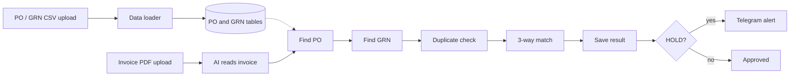
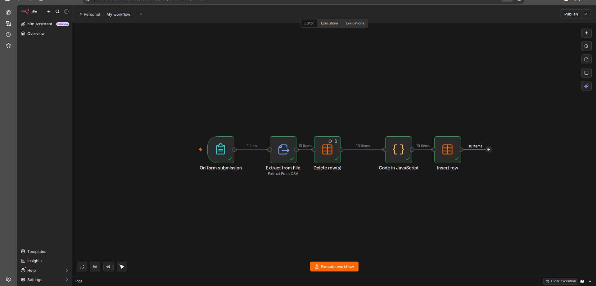
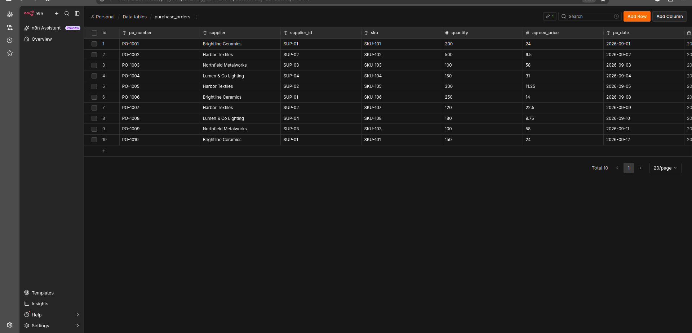
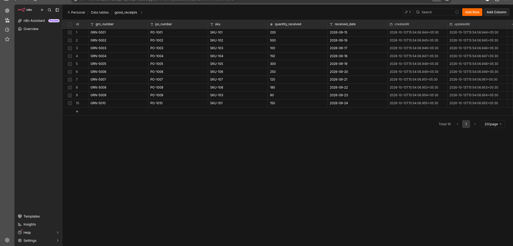
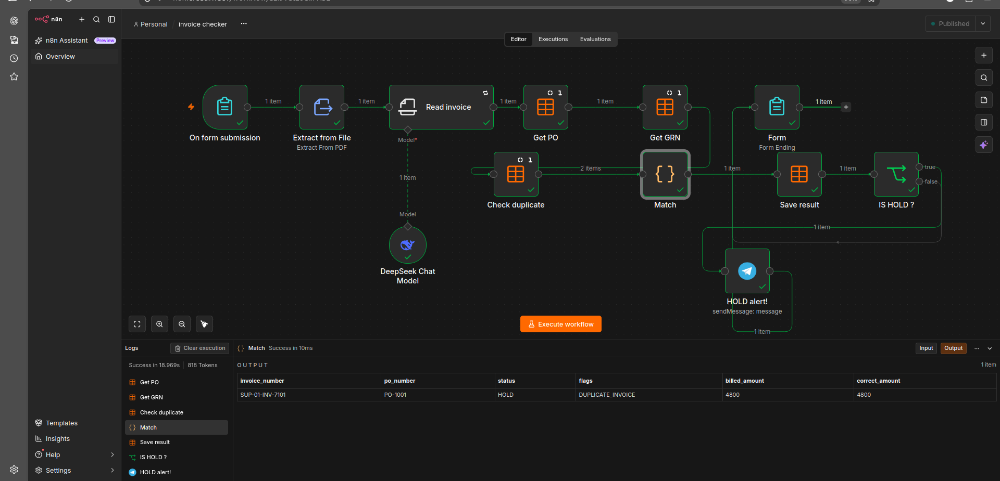
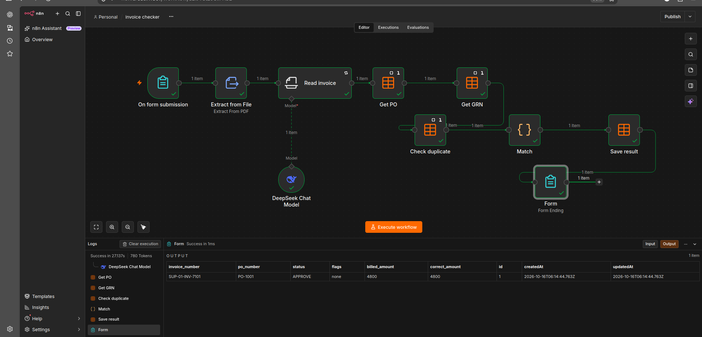
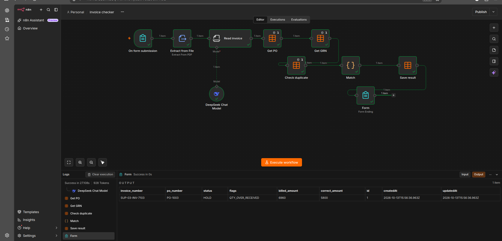
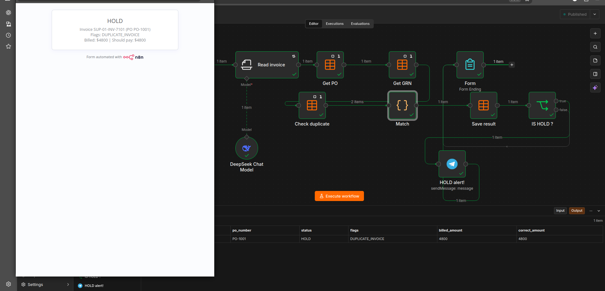
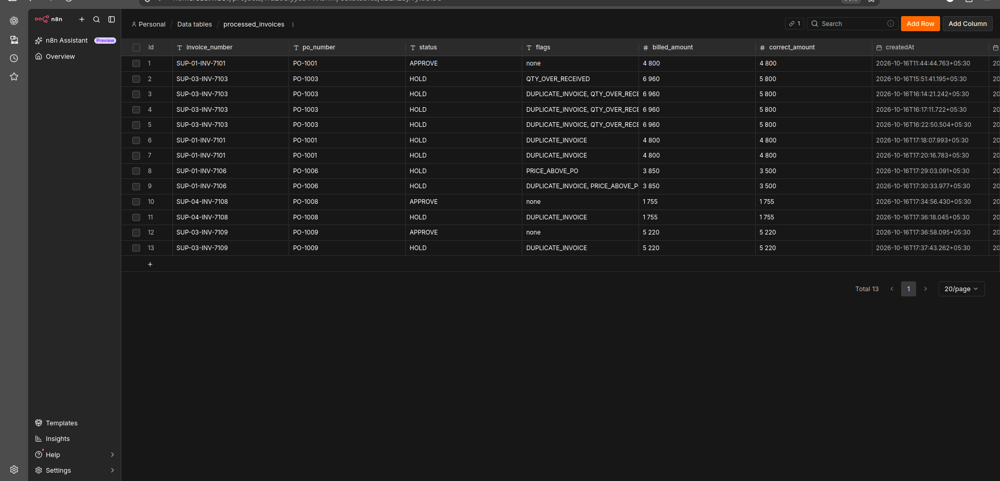
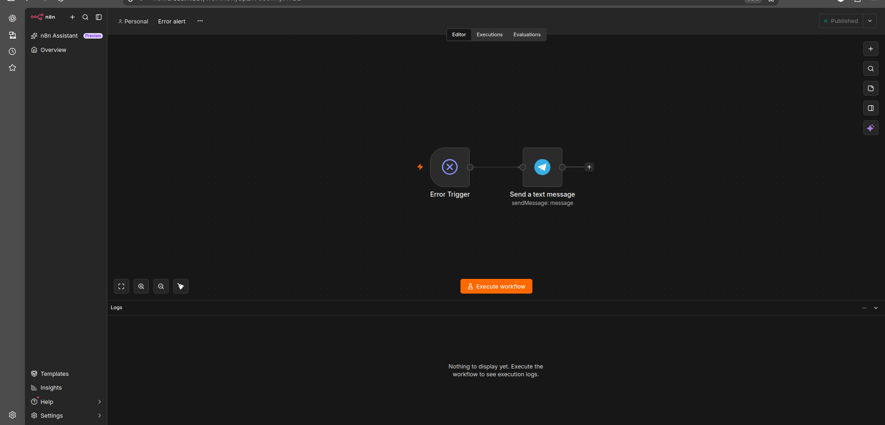

# Atlas Invoice Checker

An n8n automation that checks every supplier invoice against the purchase order (PO) and the goods receipt (GRN) before payment. This is called a 3-way match.

Clean invoices are approved. Wrong invoices are put on HOLD, and an alert is sent to Telegram straight away.

## The problem

Finance teams check invoices by hand. They open the PO, open the GRN, and compare the numbers line by line. It is slow, and mistakes get through: duplicate invoices, overbilling, and charging for goods that never arrived.

## What it does

It has two parts.

**Part 1: Data loader.** Upload a CSV of purchase orders or goods receipts through a form. The loader clears the old rows, cleans the numbers, and saves fresh data. The checker always matches against up-to-date records.

**Part 2: Invoice checker.**

1. A supplier invoice (PDF) is uploaded through a simple form.
2. AI reads the invoice and pulls out the invoice number, PO, item, quantity, price and total.
3. The workflow finds the matching PO and GRN.
4. It checks for a duplicate invoice.
5. It compares the billed amount with what should be paid.
6. The result is saved: **APPROVE** or **HOLD**, with the reason.
7. Every HOLD sends an instant Telegram alert.
8. If the workflow itself fails, a separate error workflow sends an alert.

## What it catches

| Flag | Meaning |
|---|---|
| `DUPLICATE_INVOICE` | The same invoice was already processed |
| `QTY_OVER_RECEIVED` | Billed for more units than were received |
| `PRICE_ABOVE_PO` | Unit price is higher than the agreed PO price |

## Results

Data loader, all nodes green (10 rows loaded):

Purchase orders table after loading:

Goods receipts table after loading:

Invoice checker, all flow nodes green on a HOLD run:

Clean invoice approved (billed 4,800 = correct 4,800):

Over-billing caught (billed 6,960, should pay 5,800):

The result page the user sees:

Every result saved with its reason:

Error alert workflow:

## Built with

- n8n, self-hosted on a VPS
- DeepSeek (AI invoice reading)
- n8n Data Tables (POs, GRNs, results)
- Telegram (HOLD and error alerts)

All sample data is invented. No real company data is used.

## Get it for your business

The full workflow is available to clients on request. It can run on your own server or your own n8n account.

---

© 2026 Devopam Dev. All rights reserved.
